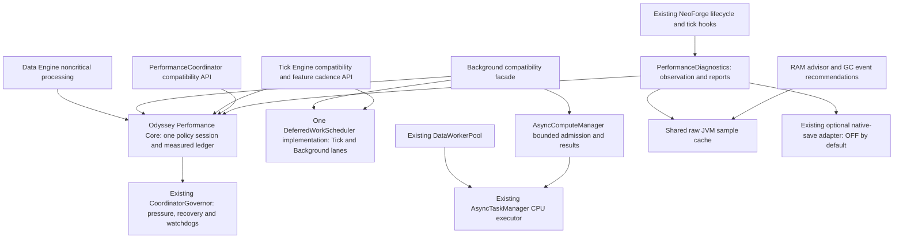

# Odyssey Performance Core: audit and implemented architecture

Audit and implementation date: 2026-10-17. Baseline: clean `in-dev` checkout, commit `a9b56c665406931b977e628cef251fc8eb5552f7`, Java 21.0.12. Scope is repository source, registrations, configuration, lifecycle and automated tests. Installed-mod presence in this developer environment is not an affected modpack compatibility result.

The detailed inventories are [feature/Data/Simulation adapters](opc-adapter-audit.md) and [workers/diagnostics/native saving](opc-diagnostics-audit.md). Those documents record pre-consolidation findings; the implementation decisions below describe the consolidation stage. The [design and execution record](opc-design.md) connects requirements to changes. A subsequent package reorganization moved the shared implementations beneath `opc/`; use the [current package map](opc-packages.md) to follow historical relative source paths below.

## Central infrastructure inventory

Paths below are relative to `src/main/java/com/thunder/wildernessodysseyapi/` unless otherwise stated. KEEP means a distinct useful responsibility, including supported extension APIs without in-repository producers. Absence of direct callers alone does not establish that a public API can be deleted.

| Component | Decision | Actual use and overlap evidence | Action / compatibility reason |
| --- | --- | --- | --- |
| `performance/coordinator/PerformanceCoordinator` | MERGE | Called by diagnostics, worker admission, Tick/Background schedulers and async shutdown. Contains the same policy session OPC needs. | Implementation moved to `performance/core/OdysseyPerformanceCore`; every original public static entry point forwards to the same session. No second coordinator instance. |
| `CoordinatorGovernor` | KEEP / IMPROVE | Called by the single OPC session; entry/chunk-pressure/overload/recovery/stop policy and module watchdogs have focused tests. | Reused pure policy, extended module accounting for Data and Tick. ADAPTIVE uses its pressure/recovery for admission and adaptive Tick helpers. |
| Tick Engine / `TickMonitor`, `TickBudgetManager`, `TickBudget` | KEEP / MERGE policy | Explicit `PerformanceServerEvents` registration from the mod event registrar; highest PRE, lowest POST. Feature adapters call `TickEngine.throttle/metrics/pressure`; server lifecycle starts/stops it. | Tick timing windows and legacy soft deadline stay useful. ADAPTIVE caps optional work through OPC, uses shared pressure/recovery, and measures real execution cost. Numeric budgets are ceilings, never summed as consumed time. |
| `TickWorkScheduler` + `BackgroundWorkScheduler` | MERGE | No in-repository production task submissions found. Lifecycle/diagnostic APIs do reference both. Tests exercise public scheduling contracts. No registration/reflection/resource entry point submits their generic tasks. | Both now adapt to one `DeferredWorkScheduler` implementation, with the same production core instance. Two compatibility lanes retain independent config/limits, tick-only expiry/coalescing, and historical priority bypass. No duplicate algorithms, worker or polling loop. Priority deques are lazy. |
| `BackgroundEfficiencyManager` | KEEP compatibility facade / IMPROVE | `ServerLifecycleEvents` and config reload start/configure/stop it; Tick Engine invokes its bounded POST pipeline. Public subsystem APIs are exposed. | Remains an integration surface, not another governor. Empty network/analytics queues skip drain scans. Its scheduler uses OPC and its compute adapter borrows shared CPU. |
| `AsyncComputeManager` private executor | REMOVE implementation / MERGE API | No production calculation submissions found; AnalyticsBatcher is its internal caller, but no production analytics channels were found. Explicit config default is false. | Removed the private ThreadPoolExecutor, thread factory, queue and shutdown ownership. Retained public snapshot/compute/apply methods with bounded session admission and shared CPU execution. See migration details below. |
| `AsyncTaskManager` / `DataWorkerPool` | KEEP | Server lifecycle owns shared CPU/IO; DataWorkerPool already borrows CPU. Aether, quest and telemetry use required IO; explicit enrichment uses disposable IO. | No new global executor. Required jobs remain independent of disposable admission. Core counters identify shared pools and child lanes without adding them together. |
| Data Engine update scheduler, dirty tracker, completion and update queues | KEEP / MERGE optional admission | Real ecosystem/weather/water/debug/simulation registrations in `ServerLifecycleEvents`, Data Engine and their integration classes. | Required critical callbacks retain their established path. ADAPTIVE constrains only noncritical processing and records its measured cost; elapsed-time and revision checks remain with feature owners. These data identities/revisions are not interchangeable runnable queues. |
| `NetworkBatcher` | KEEP compatibility API / IDLE | No production channel registrations found. Typed caller-defined payload aggregation, thread-safe recipient maps and recipient-local arbitrary dedup keys. | Not safely interchangeable with DataSyncManager's DataDelta/priority/interest/byte-budget semantics. No producer was migrated or public channel removed on speculative external-use assumptions. Empty pump work is skipped. New in-repo state sync should use DataSyncManager. |
| `AnalyticsBatcher` | KEEP compatibility API / IDLE | No production channel registrations found; tests use the API. Real telemetry has its own durable retry spool and required IO path. | No replacement analytics facility added. No active job, thread or channel scan when idle. Deprecated behavior should only be removed in a versioned API migration; using this API for native saves remains unsupported. |
| `ActivityManager` | KEEP small public helper | Accessor is public; no production calls to `BackgroundEfficiencyManager.activity()` found. Production uses `ActivityLevel` across ecosystem/simulation/throttle policy. | Stateless helper has no background thread or tick work. Deleting it saves no observed hot-path work and could break extensions. |
| `TickDebtManager` / `TickDebtAware` | KEEP public opt-in contract | Exposed/configured by Tick Engine, tested; no production call to `TickEngine.debt().process` found. | No per-tick debt simulation is introduced. Preserve maximum individual-step and elapsed-time aggregation semantics. |
| `AdaptiveEntityWork`, `AdaptiveBlockEntityTicker` | KEEP public adapters / IDLE | No production consumers found. Subsystem-specific opt-in helpers, not vanilla tick interceptors or event subscribers. | Do not delete exported helper types solely for naming/size. No queue/thread/polling cost while unused. |
| `AdaptiveThrottle`, `SubsystemPolicy` | KEEP / MERGE pressure input | Active weather/ecosystem/water/simulation cadence callers. | Preserve feature-specific intervals and elapsed simulation anchors. ADAPTIVE uses the OPC pressure and recovery source; LEGACY retains existing configuration behavior. |
| `ElapsedTimeSimulation` | KEEP | Used by `simulation/core/SimulationCoordinator` to calculate actual elapsed ticks. | Removing it would change simulation correctness; deferral must not advance simulation as if every request ran immediately. |
| RAM advice / `GcMonitor` / JVM diagnostics | MERGE raw sampling / KEEP analyses | Independent RAM event subscriber and optional diagnostics both read JVM beans. RAM GC notifications carry different post-GC/cause/duration facts. | `JvmMetrics` caches raw MXBean observations for at most one second with no new thread. Each diagnostics adapter computes its own interval GC fraction using actual capture times; RAM recommendations retain notification data. |
| GPU/VRAM / loading / shutdown diagnostics | KEEP distinct lifecycle | Client command/render hooks, a client-lifetime loading-stall monitor, and native/server lifecycle timing are actually registered. | Retain client isolation and opt-in GPU profiling. `/wo perf` exposes core status/queues/RAM/save/ownership; GPU command and loading report locations are documented. No GL class is loaded from common code. |
| `SavingCoordinator` / dirty index | EXPERIMENTAL / DISABLED drain | Diagnostics initializes it only behind opt-in observation/control and ownership/instrumentation checks. Native save mixins observe dirty/write readiness and completion. | saveDrain remains OFF; no source changes to serialization, dirty flags, save readiness, save-owner veto, native IO order, or vanilla chunk scheduling. Pending native writes are never made optional. |
| Simulation Engine, ecosystem/weather/water adapters, vegetation owner | KEEP / IMPROVE selectively | Active feature ownership, fallbacks, deterministic revision validation and elapsed-time behavior are detailed in the adapter audit. | Preserve authorities and loaded-only world access. These are not redundant generic schedulers. Further per-region/per-chunk live-time seams are documented pending work, not silently claimed as completed. |

Repository searches included production Java call sites, explicit event-bus registration, auto subscribers, mixin JSON/plugin selection, config loading/reloading, startup/shutdown, tests and public exposure. No evidence was found that reflection instantiates the supposedly unused generic schedulers/batchers. This cannot prove that external mods do not use public APIs; compatibility facades therefore remain.

## Final ownership and communication

Native Minecraft/NeoForge tick allowance, chunk generation/lighting, chunk tickets, serialization, IO, networking correctness and feature physics remain outside this policy graph. The graph denotes communication, not transferred ownership. World/entity/chunk mutations remain on the server thread. Client GPU/loading implementations stay separate.

The two deferred lanes preserve different public contracts and can be enabled independently. Their shared engine is intentionally not flattened into Data Engine: generic runnable coalescing and expiry cannot replace dirty identity, generation-aware completion, interest-managed DataDelta delivery or elapsed-time simulation. The shared queue engine serializes short admission/lifecycle mutations; callbacks execute outside the lock. Clear invalidates old requeues through a generation token.

ADAPTIVE optional allowance is the smaller of configured request, current tick headroom, total remaining OPC allowance and the module's fair per-tick ceiling. Four module ceilings reserve opportunities for Data, Tick, Background and Save even when an earlier module is busy. Unused shares are not banked or redistributed into a recovery burst. This is deliberately conservative: inactive modules leave some allowance unused. Repeated non-preemptible overruns back off through the existing watchdog. CRITICAL and Tick GAMEPLAY priorities keep their existing local-budget bypass while still observing the live NeoForge allowance. Required callback cost reduces subsequent headroom; the governor never cancels required shared work.

## Configuration, rollout and rollback

The unified SERVER file is `config/wildernessodysseyapi/wildernessodysseyapi-server.toml`. Existing COMMON async-thread settings and CLIENT diagnostics stay on their original logical side. Existing three-file/create-only configuration migration is unchanged; no file is overwritten or renamed by this change.

| `performance.opc.mode` | Result after world/server restart |
| --- | --- |
| `LEGACY` (default) | Honors `performance.coordinator.enabled` (default false); existing engine defaults and tuning continue to apply. |
| `OFF` | No OPC observation or coordinator controls; existing feature/engine settings still apply. |
| `OBSERVE` | Bounded diagnostics and optional recording; no OPC work governor or optional save drain. |
| `ADAPTIVE` | Bounded diagnostics plus shared optional Data/Tick/Background admission, existing worker-admission policy, recovery and watchdogs. |

`performance.coordinator.observation=OFF` continues to disable observation and controls even in an explicit OPC mode. Numeric budgets, sample/record levels, asyncGovernor, cooldowns and experimental save settings retain their existing `performance.coordinator.*` keys as the **single set of tuning values**. `performance.safeMode=true`, `saveDrain=OFF`, and the background compute feature's disabled default remain unchanged. `asyncGovernor=OFF` preserves existing worker/scheduler admission; optional native saving is separately gated. Changing OPC mode or coordinator tuning requires restart, matching the existing session-captured policy.

Rollback: set mode to LEGACY and restart; optionally set the old coordinator master false. Source/binary rollback remains possible because no save-data schema, resource ID, world migration or destructive config rewrite was added. Scheduler fairness and shared-worker consolidation remain in the new source regardless of mode; restoring the prior binary restores their old implementation.

### External compute API migration

Public AsyncComputeManager constructors, submit methods, callback types, settings and snapshots remain. The server lifecycle must initialize AsyncTaskManager before an external compute lane is enabled. A disabled/unavailable/saturated shared executor rejects promptly and never runs work on the caller.

`workerThreads` is retained as a legacy admission weight. The total outstanding limit is `workerThreads + maximumQueuedJobs`, including computed results waiting for application. Physical concurrency now follows `asyncThreading.maxThreads`: **workerThreads=1 no longer guarantees only one active calculation** if the shared CPU executor has more workers. Snapshot `workerThreads` reports that compatibility setting, not a second physical pool size. Shared pool gauges are authoritative for threads. Clients requiring stricter sequencing must keep their feature-owned dependency/order contract; a second pool is not restored implicitly.

Each accepted result-bearing computation reserves capacity before dispatch. All successful results fit within the total outstanding bound; publication and queue-size observation share one lock. Shutdown/reinitialize invalidates the old session, and late calculations cannot publish into its successor. It neither interrupts nor shuts down the shared executor. Existing intentionally discarded late-session work and isolated compute/apply exception handling remain; exceptions are counted and rate-limited.

## Operator interface

- `/wo perf` or `/wo perf status`: mode/state, active engines, shared CPU/IO activity and queues even when detailed observation is disabled; enabled sessions additionally show MSPT, heap, GC pressure, configured allowance and recording state.
- `/wo perf queues` and existing `/wo perf async`: bounded pool/child-lane queues and per-module measured costs/watchdog cooldowns. Background and Data worker gauges are subsets of shared CPU totals; do not add them together.
- `/wo perf ram`: existing RAM recommendation report. `/wo ram`, status and reset remain supported.
- Existing `/wo perf save`, `worldgen`, `ownership`, `record start/stop`, `export` remain. Export is bounded and queued; an accepted export is not proof that the file was written.
- Client GPU/VRAM remains `/wovram start`, `status`, `gpu`, `errors`, `leaks`, `export`, `stop`. It is manual and requires a client GL context. Server diagnostics never start GPU profiling.
- Client loading recovery diagnostics remain in `logs/loading-stalls`; startup/shutdown/native timing is in OPC reports. A stalled render/server thread still needs the independent client diagnostic monitor.

## Actual performance changes and limits

Confirmed source changes: one secondary CPU executor implementation removed; two generic queue algorithms reduced to one; empty lanes have no allocated priority deques; empty compatibility batchers skip scans; debug metrics do not dirty/build/encode a payload without subscribers; coincident RAM/diagnostic MXBean reads share a raw sample; adaptive modules debit one ledger using elapsed cost. Result-publication and starvation regressions are corrected.

No FPS, MSPT, RAM reduction, loading speedup or Save & Quit speedup has been measured. No in-repository tasks/channels used the background generic queue/secondary CPU executor, so their consolidation chiefly reduces maintenance and latent contention risk. The real production changes most likely to matter are unsubscribed debug work, duplicate JVM reads, and opt-in pressure admission for active Data adapters. Their magnitude requires profiling. Added admission checks/short locks have a cost too; fewer classes or queues alone is not a benchmark.

Retained costs with distinct responsibilities: RAM checks a monotonic timestamp each tick; Tick and diagnostics retain different bounded timing windows; Data Engine maintains spatial player interest, dirty/scheduled/completion state and feature-specific network batching; client stall monitoring remains independent. The conservative four-way share may reduce optional throughput in ADAPTIVE mode. Callbacks/native serialization are cooperative and cannot be preempted; an unexpectedly long admitted step can exceed the allowance before backoff takes effect.

## Compatibility review and pending profiling

Existing presence detection recognizes ModernFix startup/resource work, FerriteCore memory deduplication, Lithium/Canary/Radium tick internals, C2ME chunk scheduling/persistence, Sodium/Embeddium terrain rendering, ImmediatelyFast rendering, ScalableLux/Starlight lighting, and known save mods. No detection was broadened into takeover permission. Presence is not proof of enabled patches. C2ME/save-owner presence still vetoes optional save draining. Feature-specific Sable/Iris/renderer guards remain independent and unchanged.

Pending work needs evidence or a separately tested compatibility migration:

1. Profile weather snapshots/surface scans, water regional/erosion tasks, vegetation chunks and SimulationCoordinator region passes. Add live allowance seams inside long callbacks before trying more aggressive shared admission. Preserve elapsed-time anchors, loaded-only access and server-thread application.
2. Reproduce Data network flush starvation under sustained processing load and enforce packet envelope limits with protocol tests. Network semantics were intentionally not rewritten in this consolidation.
3. Profile shared pool capacity/retired-pool overlap during repeated reloads; preserve accepted required IO before imposing an overlap cap.
4. Bound GPU snapshot/unique-attribution retention and inspect client audio queue shutdown separately. These have client-specific lifecycles and are not silently fixed by server OPC.
5. Verify first-world/existing-world loading, integrated-world restart, dedicated server, two-client synchronization, copied-world save/reload, and relevant optimization-mod combinations. Use actual affected-pack reports for native delays; unit tests do not attribute a launcher's shutdown/loading delay.

Final commands and exact counts belong in [opc-validation.md](opc-validation.md). Live pack and visual/GPU acceptance remain separate from automated source/native-fixture proof.
